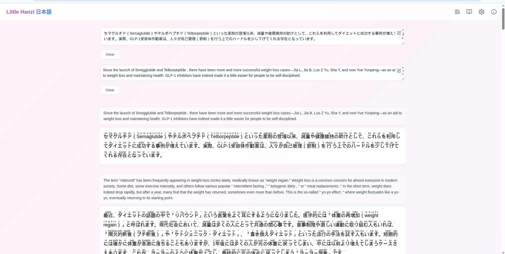

# Little Hanzi 日本語

A clean, focused Japanese reading tool. Paste Japanese text alongside its English translation, and read paragraph-by-paragraph with furigana (romaji annotations) rendered above the Japanese. Built for language learners who want to read real Japanese without drowning in a dictionary.

I couldn't find an open-source tool that did exactly this, so I built one — for myself first, then for anyone else with the same problem.

## Screenshot



**Live Demo:** [Little Hanzi 日本語](https://amaan-samar.github.io/Little_Hanzi_Japanese/)

## What is this?

Little Hanzi 日本語 lets you paste Japanese text and its English translation, then displays them interleaved paragraph-by-paragraph with romanized pronunciation rendered directly above the Japanese characters. Perfect for reading practice, vocabulary building, and — with the bookmark feature — resuming exactly where you left off.

## Features

### Reading
- **Paragraph-by-paragraph reading** — Japanese and English paired per paragraph, with configurable order (JA → EN or EN → JA)
- **Furigana / romaji** — Kanji annotated with romanized readings, powered by Kuroshiro (works fully offline)
- **Three romanization systems** — Hepburn (learner-friendly), Nippon-shiki (strict), and Passport (official)
- **Per-paragraph bookmark** — One bookmark per article so you can resume reading exactly where you stopped

### Editing & History
- **Automatic saving** — Articles autosave a minute after your last edit
- **Manual save** — Save on demand without waiting for autosave
- **Reading history** — All saved articles appear in a history panel, filterable by date and "unfinished reads"
- **Persistent article context** — Editing a loaded article updates it in place; only *Clear All Text* starts a fresh article
- **Copy paragraph** — One-tap copy of a paragraph's plain Japanese text (handy when you need to search a word elsewhere)

### Customization
- **Font size** — Independently adjustable for Japanese, romaji, and English
- **Font family** — Noto Sans JP, Noto Serif JP, Inter, Roboto, Poppins
- **Display toggles** — Show/hide romaji, Japanese, or English independently
- **Settings persist** — Preferences saved to `localStorage` and restored on next visit

### Sharing & Installation
- **PWA install** — Install to your home screen or desktop for a native-feeling app
- **Offline support** — Kuroshiro dictionary bundled; works without a network after install
- **Share to Little Hanzi** — Share text from any app (including your browser) and it opens Little Hanzi with the text pre-filled in the Japanese or English field. Language is auto-detected; ambiguous cases ask you which field to use

## Demo Content

The `/data` folder contains sample articles:

- `jp.txt` — Japanese text samples
- `en.txt` — English translations

Paste these into the app to try it out.

## Setup

```bash
# Clone the repo
git clone https://github.com/Amaan-Samar/Little_Hanzi_Japanese.git

# Install dependencies
npm install

# Run locally
npm run dev

# Build for production
npm run build

# Preview the production build
npm run preview
```

The dev server runs at `http://localhost:3000/Little_Hanzi_Japanese/`. Note the base path prefix — the app is built to deploy under `/Little_Hanzi_Japanese/` for GitHub Pages.

## How the Share Target Works

Once installed as a PWA, Little Hanzi 日本語 appears in your system share sheet. Selecting text in any app and choosing *Share → Little Hanzi 日本語* opens the app and pre-fills the appropriate text field.

- **Japanese text** (kana/kanji dominant) → lands in the Japanese field
- **English text** (Latin dominant) → lands in the English field
- **Ambiguous or short text** → you're asked which field to use (one tap)

The share target only appears for installed PWAs. It works on Chrome (Android and Desktop). iOS Safari does not currently support `share_target` in PWAs.

## Tech Stack

- **Vue 3** — Composition API, `<script setup>`
- **Vite** — build tool and dev server
- **vite-plugin-pwa** — PWA manifest and service worker generation
- **Kuroshiro** (`kuroshiro-browser`) — Japanese morphological analysis and furigana generation, fully offline via bundled Kuromoji dictionary
- **Tailwind CSS** — utility styling in modal components
- **Vue Router** — history mode with base-path awareness
- **Lucide** — icon set

## Project Structure

```
Little_Hanzi_Japanese/
├── public/
│   ├── icons/                    # PWA icons
│   └── dict/                     # Kuromoji dictionary files (offline)
├── data/
│   ├── jp.txt                    # Sample Japanese text
│   └── en.txt                    # Sample English translation
├── src/
│   ├── components/
│   │   ├── ArticleHistoryModal.vue
│   │   ├── ConfirmModal.vue
│   │   ├── EditModal.vue
│   │   ├── InfoModal.vue
│   │   ├── LoadingSpinner.vue
│   │   └── SettingsModal.vue
│   ├── composables/
│   │   ├── useArticleHistory.js  # Article storage + context management
│   │   └── useSettings.js        # Settings persistence
│   ├── views/
│   │   ├── JapaneseConverter.vue # Main editor
│   │   └── ShareHandler.vue      # Share-target landing page
│   ├── router/
│   │   └── index.js
│   ├── App.vue
│   ├── main.js
│   └── style.css
├── index.html
├── vite.config.js                # PWA manifest inline here
├── tailwind.config.js
├── postcss.config.js
└── package.json
```

## Development Notes

### Article Context Rules

The app tracks a single "active article" at a time. Understanding this makes the save behavior predictable:

| Action | Result |
|---|---|
| Type text, click **Save** | New article created |
| Type more, wait 1 min (autosave) | Same article updated |
| Load from **History** | That article becomes active |
| Edit loaded article | Same article updated — **no duplicates** |
| Add or move a bookmark | Same article updated |
| Clear **one** textarea | Context preserved (still an edit) |
| Click **Clear All Text** | Context ends; next paste starts a new article |
| Reload page | Context resets (fresh session) |

Autosave never creates new articles. Only **Save** or adding a **first bookmark** to new content creates one.

### Bookmark UX

- Click a paragraph → it gains a subtle highlight and shows a ⋮ menu (top-right)
- **⋮ → Bookmark this paragraph** sets the bookmark
- **⋮ → Copy paragraph** copies the plain Japanese
- **Double-click** (desktop) / **double-tap** (mobile) on any paragraph toggles the bookmark directly
- The bookmarked paragraph always shows a filled pink bookmark icon; click it to clear
- Only one bookmark per article

### Testing the Share Target Locally

The share target requires PWA installation, which is inconvenient during development. You can test the routing and pre-fill logic without installing by visiting the share-handler URL directly:

```
http://localhost:3000/Little_Hanzi_Japanese/share-handler?text=%E3%81%93%E3%82%93%E3%81%AB%E3%81%A1%E3%81%AF
```

You should see a brief "Loading…" or a picker (for short text), then be redirected to the editor with the text pre-filled.

## About the Author

Built by [Amaan Samar](https://github.com/Amaan-Samar) — a language learner who got tired of reading
textbook Japanese and wanted a tool to read real articles.

### More Little Hanzi apps

- [Little Hanzi Chinese](https://amaan-samar.github.io/Little_Hanzi_Chinese/) — pinyin + English, paragraph by paragraph
- [Little Hanzi Greek](https://amaan-samar.github.io/Little_Hanzi_Greek/) — Greek + English, paragraph by paragraph
- [Little Hanzi Korean](https://amaan-samar.github.io/Little_Hanzi_Korean/) — Korean + English, paragraph by paragraph

## License

MIT
