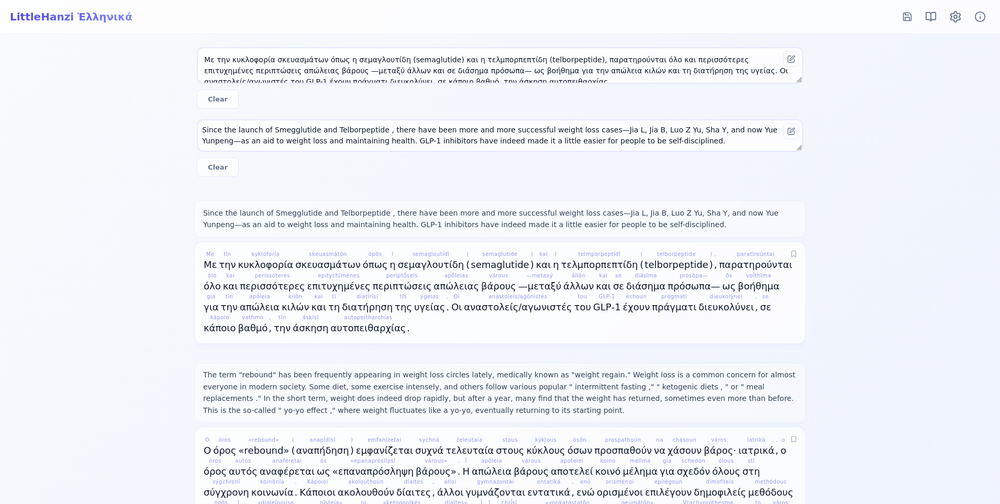

# LittleHanziGreek

Little hanzi Greek is a nice simple that i created to make Greek learning process simple efficient and clean. It teches Greek via read articles. I was looking for something similar solution in the open source solution, and could not find any so i decided to create this for myself. Latter on i made it pubic so that if there is some else stuck in the same problem as me, They can use it.


## Screenshot



**Live Demo:** [Little Hanzi](https://amaan-samar.github.io/Little_Hanzi_Japenese/)
## What is this?

Little Hanzi Greek lets you paste GReek text and its English translation, then displays them with lanized pronunciation rendered with its greek and english paragrah for understing meaning. Perfect for reading practice and vocabulary building.

## Features

- **Paragraph by paragraph reading** - Compare Greek and English text
- **Pinyin support** - Toggle romanization on/off above Greek characters
- **Customizable** - Change font size, font family, and display order
- **Mobile friendly** - Works on phones and tablets
- **Works offline** - Install as PWA on your device
- **Settings save** - Your preferences are remembered

## Demo Content

The `/data` folder contains sample articles:
- `cn.txt` - Greek text samples
- `en.txt` - English translations

Copy these into the app to see how it works.

## Setup

```bash
# Clone the repo
git clone https://github.com/Amaan-Samar/LIttle_Hanzi_Japenese.git

# Install dependencies
npm install

# Run locally
npm run dev

# Build for production
npm run build
```

## Tech Stack

- Vue 3
- Vite
- @humanities/greek-conversion

## License

MIT
```